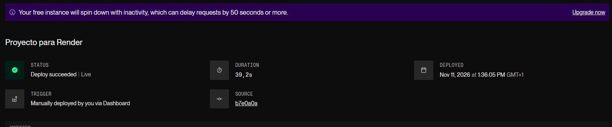
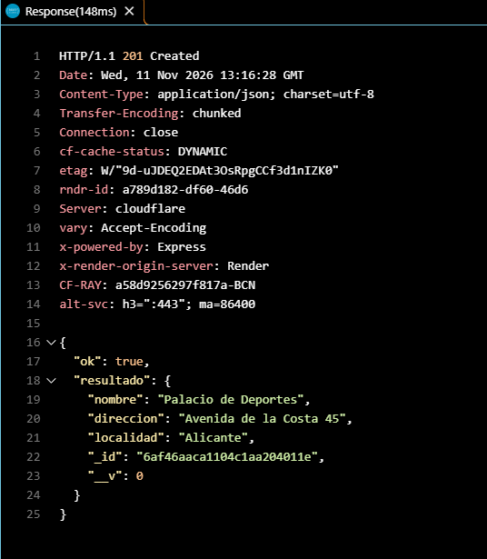
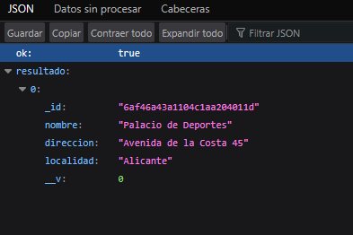
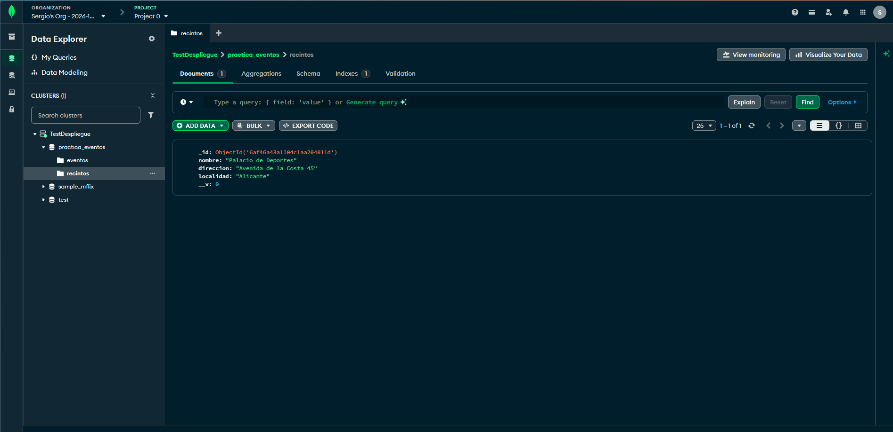

## Declaración de Uso de IA y Auditoría de Código

### Uso de herramientas de IA
Para la fase inicial del proyecto se utilizaron las herramientas de IA sugeridas (`Antigravity con el LLM Gemini Flash 3.8`) como asistencia en la generación del esqueleto base de las rutas de Express y la definición inicial de los esquemas de Mongoose. Las instrucciones seguidas por el LLM se encuentran en `agents.md`.

### Auditoría y adaptaciones manuales.
Todo el código generado fue revisado y corregido manualmente para cumplir las especificaciones de la práctica. A continuación se explicaran de manera breve los cambios hechos en el codigo:

- ### En modelos(`/models`).
    - Se corrigieron los nombres de los modelos en Mongoose (`'eventos'`, `'recintos'`) en minúsculas y plural (como se recomendaba en clase), asegurando que los campos `ref` coincidieran exactamente para permitir el uso de `.populate()`.

- ### En enrutadores(`/routes`).
    - ### En `recintos.js`
        - **Estandarización de respuestas en los servicios:** Se unificó el formato JSON de salida de toda la API bajo la estructura `{ ok: boolean, resultado / error }`.
        - **Seguridad en POST /recintos:** Se sustituyó la asignación directa de req.body hecha por la IA por la desestructuración explícita de parámetros ({ nombre, direccion, localidad, aforo }) al instanciar el modelo new Recinto({...}), impidiendo la inyección de atributos no permitidos.
        - **Inclusión de comprobación auxiliar en DELETE/recintos/:id**: A traves de esta se evita el borrado de recintos si estos tienen eventos asignados (para que no se queden con referencias borradas), aunque se tuvo que simplificar (dado que todo se unifica en error 404) el mensaje de error para cumplir con los criterios de la práctica.
    
    - ### En `eventos.js`
        - **Estandarización de respuestas en los servicios:** Se unificó el formato JSON de salida de toda la API bajo la estructura `{ ok: boolean, resultado / error }`.
        - **Seguridad en POST /eventos y PUT /eventos/:id:** se aplicó de la misma forma que en `recintos.js` la extracción explícita de los campos del esquema de eventos ({ nombre, fecha, entradas, recinto }), impidiendo la inyección de atributos no permitidos.

- ### En el servidor(`index.js`).
    - No se detecto ningun error concreto en este fichero.

## Despliegue en Producción

La aplicación está desplegada en **Render** y conectada a **MongoDB Atlas**:
- **URL Base:** `https://despliegue-de-aplicaciones-web-practica-1.onrender.com`

## Pruebas de Funcionamiento

Para las pruebas solo se utilizo un par de endpoints de recintos:
- **Endpoint Recintos:** `https://despliegue-de-aplicaciones-web-practica-1.onrender.com/recintos`

Las pruebas de los endpoints se han realizado mediante el archivo de peticiones [`pruebas.http`](./pruebas.http).

### 0. Server correctamente iniciado en Render.

> **Nota sobre la ruta raíz (`/`):** La API solo expone los endpoints definidos exigidos (`/recintos` y `/eventos`). Al acceder a la URL base raíz (`/`), el servidor devolverá una respuesta `404 Not Found`, lo cual es el comportamiento esperado (y concretado en las lineas 22-27 de `index.js`) al no haberse configurado un endpoint para dicha ruta.

### 1. Creación de Recinto (`POST /recintos`).
Respuesta `201 Created` al enviar los datos del recinto desde la extensión **REST Client** en VS Code:

### 2. Consulta de Recintos (`GET /recintos`).
Confirmación de respuesta en formato JSON al acceder a la ruta `GET` en el navegador:

### 3. Persistencia en MongoDB Atlas.
Comprobación del documento insertado en la colección `recintos` dentro del cluster de Atlas:

